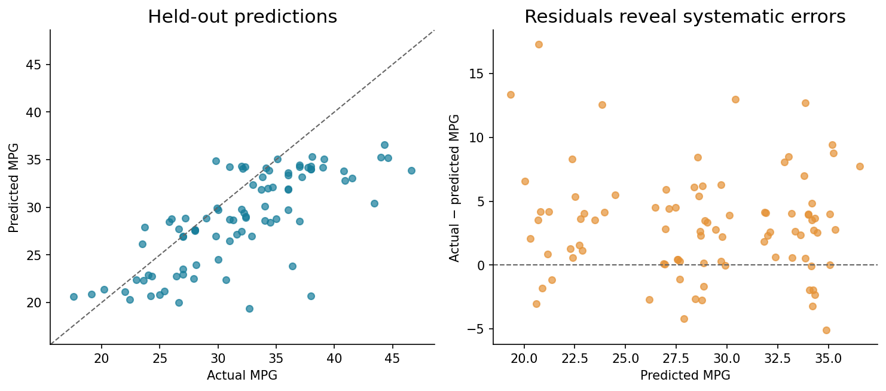

# Auto MPG: Prediction Across Model Years

[Open the executed notebook](analysis.ipynb) · [Data provenance](data/README.md)

**Question:** Can models trained on 1970s vehicles predict fuel efficiency for 1980–1982 vehicles?

## Held-out results

| Measure | Result |
|---|---:|
| Selected model | random_forest |
| Training / test rows | 309 / 89 |
| Test MAE | 3.93 MPG |
| Training-median baseline MAE | 11.98 MPG |
| MAE reduction versus baseline | 67.2% |
| Test RMSE | 5.14 MPG |
| Test R² | 0.287 |
| Mean residual (actual − predicted) | 3.13 MPG |

## Method and limits

Use all 398 historical records, including six with missing horsepower. Train through 1979 and hold out 1980–1982. Within the training years, validate on 1975, 1976, 1977, 1978, and 1979, each time fitting only earlier years. Compare fixed ridge and random-forest models with a median baseline; select by mean year-level MAE. Median imputation, scaling, and categorical encoding are fitted inside each pipeline. Car names are excluded from features.

The notebook includes residual plots, the largest prediction errors, and a year-by-year test breakdown. Positive mean residual indicates average underprediction. Changes in vehicle mix limit transfer across years. Related models can cross the boundary, and model years are not actual acquisition timestamps. These historical results do not describe modern cars or causal effects.



## Data source

Quinlan, R. (1993). Auto MPG [Dataset]. UCI Machine Learning Repository. https://doi.org/10.24432/C5859H

[CC BY 4.0](https://creativecommons.org/licenses/by/4.0/). Details and any transformations are documented in [data/README.md](data/README.md).

## Run it

Use Python 3.12. From this project's folder:

```bash
python -m venv .venv
```

Activate it on Windows PowerShell with `.venv\Scripts\Activate.ps1`, or on macOS/Linux with `source .venv/bin/activate`.

```bash
python -m pip install -r requirements.txt
python -m jupyterlab
```

Open `analysis.ipynb` and choose **Restart Kernel and Run All Cells**. The included data permits offline analysis after dependency installation. To execute and verify all cells without opening the interface:

```bash
python run_notebook.py
```

Or run the companion script with `python analysis.py` from the project folder. `run_notebook.py` refreshes notebook outputs and files under `results/`; the script refreshes only result files. The repository-level GitHub Actions workflow runs each project separately. The workflow inside this folder is a template for copying the project into a standalone repository.

## Files

- `analysis.ipynb`: narrative, code, executed tables, and charts.
- `analysis.py`: the same analysis as a readable Python script.
- `data/`: bundled source data, attribution, and a SHA-256 provenance record.
- `results/`: generated charts, tables, metrics, splits where applicable, and package versions.
- `requirements.txt`: pinned direct dependencies.
- `run_notebook.py`: clean-kernel execution with errors treated as failures.

## Reproducibility and credit

Random operations use seed 42. Raw data hashes are checked before analysis. Notebook assertions verify key data and split assumptions. The included `results/environment.json` records the executed environment; direct dependencies are pinned, while transitive dependencies may vary across installations.

Code is MIT licensed. Dataset licenses are separate and listed in `data/README.md`.

## Learning resources

- [Jupyter](https://jupyter.org): the notebook environment.
- [Kaggle](https://www.kaggle.com) and [competitions](https://www.kaggle.com/competitions): dataset discovery and follow-up practice.
- [Beginner Jupyter projects on GitHub](https://github.com/topics/beginner-project?l=jupyter+notebook&o=asc&s=stars): portfolio examples, not code sources for this project.
- [scikit-learn guidance on leakage and preprocessing](https://scikit-learn.org/stable/common_pitfalls.html).

The source data was downloaded from its original provider. No Kaggle entry, competition participation, or leaderboard score is claimed.
