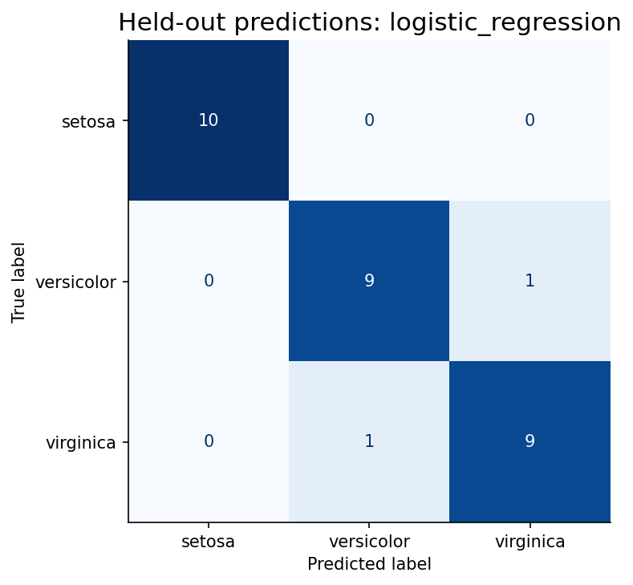

# Iris Species Classification

[Open the executed notebook](analysis.ipynb) · [Data provenance](data/README.md)

**Question:** Can four iris measurements classify species better than a majority-class baseline?

## Held-out results

| Measure | Result |
|---|---:|
| Selected model | logistic_regression |
| Training / test rows | 119 / 30 |
| Correct test labels | 28 / 30 |
| Test accuracy | 93.3% |
| Test macro F1 | 0.933 |
| Baseline accuracy | 33.3% |
| Approximate 95% Wilson accuracy interval | 78.7%–98.2% |

## Method and limits

The original 150-row dataset is retained unchanged. Two source-documented measurement corrections are applied in memory, then 1 identical feature-and-label rows are removed before a seeded stratified 80/20 split. Logistic regression and k-nearest neighbors are compared with a majority baseline using five-fold cross-validation on training data. Select by mean macro F1; scaling is fitted separately inside each fold. The selected model and baseline are then evaluated on the same held-out set. Full candidate scores, predictions, and error cases are included.

The test set is small, so one label changes accuracy substantially. This curated, balanced dataset is not evidence of field performance or image recognition. The interval assumes independent test observations. No repeated seed search was used to improve the score.



## Data source

Fisher, R. (1936). Iris [Dataset]. UCI Machine Learning Repository. https://doi.org/10.24432/C56C76

[CC BY 4.0](https://creativecommons.org/licenses/by/4.0/). Details and any transformations are documented in [data/README.md](data/README.md).

## Run it

Use Python 3.12. From this project's folder:

```bash
python -m venv .venv
```

Activate it on Windows PowerShell with `.venv\Scripts\Activate.ps1`, or on macOS/Linux with `source .venv/bin/activate`.

```bash
python -m pip install -r requirements.txt
python -m jupyterlab
```

Open `analysis.ipynb` and choose **Restart Kernel and Run All Cells**. The included data permits offline analysis after dependency installation. To execute and verify all cells without opening the interface:

```bash
python run_notebook.py
```

Or run the companion script with `python analysis.py` from the project folder. `run_notebook.py` refreshes notebook outputs and files under `results/`; the script refreshes only result files. The repository-level GitHub Actions workflow runs each project separately. The workflow inside this folder is a template for copying the project into a standalone repository.

## Files

- `analysis.ipynb`: narrative, code, executed tables, and charts.
- `analysis.py`: the same analysis as a readable Python script.
- `data/`: bundled source data, attribution, and a SHA-256 provenance record.
- `results/`: generated charts, tables, metrics, splits where applicable, and package versions.
- `requirements.txt`: pinned direct dependencies.
- `run_notebook.py`: clean-kernel execution with errors treated as failures.

## Reproducibility and credit

Random operations use seed 42. Raw data hashes are checked before analysis. Notebook assertions verify key data and split assumptions. The included `results/environment.json` records the executed environment; direct dependencies are pinned, while transitive dependencies may vary across installations.

Code is MIT licensed. Dataset licenses are separate and listed in `data/README.md`.

## Learning resources

- [Jupyter](https://jupyter.org): the notebook environment.
- [Kaggle](https://www.kaggle.com) and [competitions](https://www.kaggle.com/competitions): dataset discovery and follow-up practice.
- [Beginner Jupyter projects on GitHub](https://github.com/topics/beginner-project?l=jupyter+notebook&o=asc&s=stars): portfolio examples, not code sources for this project.
- [scikit-learn guidance on leakage and preprocessing](https://scikit-learn.org/stable/common_pitfalls.html).

The source data was downloaded from its original provider. No Kaggle entry, competition participation, or leaderboard score is claimed.
