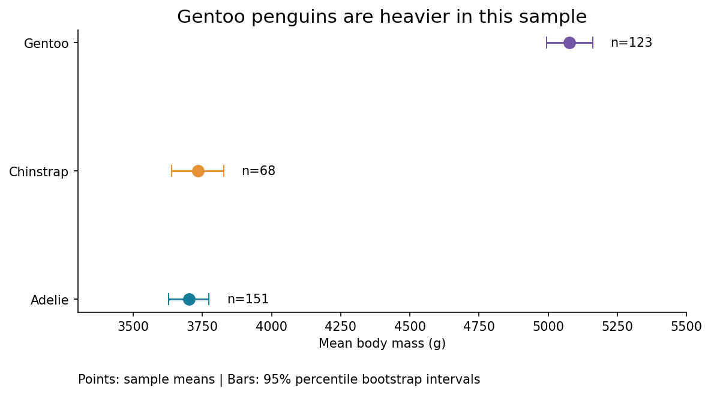

# Palmer Penguins: Exploratory Data Analysis

[Open the executed notebook](analysis.ipynb) · [Data provenance](data/README.md)

**Question:** How do species differ in body mass, and does a pooled flipper–mass correlation hide differences among groups?

Using 344 public Palmer Penguin records, this project audits missing values, builds grouped summaries, visualizes relationships, and bootstraps species mean masses.

## Findings

- 342 rows contain the required morphology values; 333 support the sex comparison.
- Pooled flipper–mass correlation: **0.871**.
- Within-species correlations: Adelie 0.468, Chinstrap 0.642, Gentoo 0.703.
- Gentoo has the highest sample mean body mass. Group composition explains part of the strong pooled association.

## Method and limits

Missing values are handled separately for each analysis. Seeded 2,000-resample bootstrap intervals describe uncertainty in species means under an independence assumption. Correlation does not establish causation; the historical, geographically limited sample may not represent broader populations. Sex and island composition can confound pooled comparisons.



## Data source

Horst, A. M., Hill, A. P., & Gorman, K. B. (2020). palmerpenguins. https://doi.org/10.5281/zenodo.3960218

[CC0 1.0](https://creativecommons.org/publicdomain/zero/1.0/). Details and any transformations are documented in [data/README.md](data/README.md).

## Run it

Use Python 3.12. From this project's folder:

```bash
python -m venv .venv
```

Activate it on Windows PowerShell with `.venv\Scripts\Activate.ps1`, or on macOS/Linux with `source .venv/bin/activate`.

```bash
python -m pip install -r requirements.txt
python -m jupyterlab
```

Open `analysis.ipynb` and choose **Restart Kernel and Run All Cells**. The included data permits offline analysis after dependency installation. To execute and verify all cells without opening the interface:

```bash
python run_notebook.py
```

Or run the companion script with `python analysis.py` from the project folder. `run_notebook.py` refreshes notebook outputs and files under `results/`; the script refreshes only result files. The repository-level GitHub Actions workflow runs each project separately. The workflow inside this folder is a template for copying the project into a standalone repository.

## Files

- `analysis.ipynb`: narrative, code, executed tables, and charts.
- `analysis.py`: the same analysis as a readable Python script.
- `data/`: bundled source data, attribution, and a SHA-256 provenance record.
- `results/`: generated charts, tables, metrics, splits where applicable, and package versions.
- `requirements.txt`: pinned direct dependencies.
- `run_notebook.py`: clean-kernel execution with errors treated as failures.

## Reproducibility and credit

Random operations use seed 42. Raw data hashes are checked before analysis. Notebook assertions verify key data and split assumptions. The included `results/environment.json` records the executed environment; direct dependencies are pinned, while transitive dependencies may vary across installations.

Code is MIT licensed. Dataset licenses are separate and listed in `data/README.md`.

This educational project was developed with ChatGPT/Codex assistance. The analysis was executed and checked; the notebook includes learning questions and suggested extensions.

## Learning resources

- [Jupyter](https://jupyter.org): the notebook environment.
- [Kaggle](https://www.kaggle.com) and [competitions](https://www.kaggle.com/competitions): dataset discovery and follow-up practice.
- [Beginner Jupyter projects on GitHub](https://github.com/topics/beginner-project?l=jupyter+notebook&o=asc&s=stars): portfolio examples, not code sources for this project.
- [scikit-learn guidance on leakage and preprocessing](https://scikit-learn.org/stable/common_pitfalls.html).

The source data was downloaded from its original provider. No Kaggle entry, competition participation, or leaderboard score is claimed.
